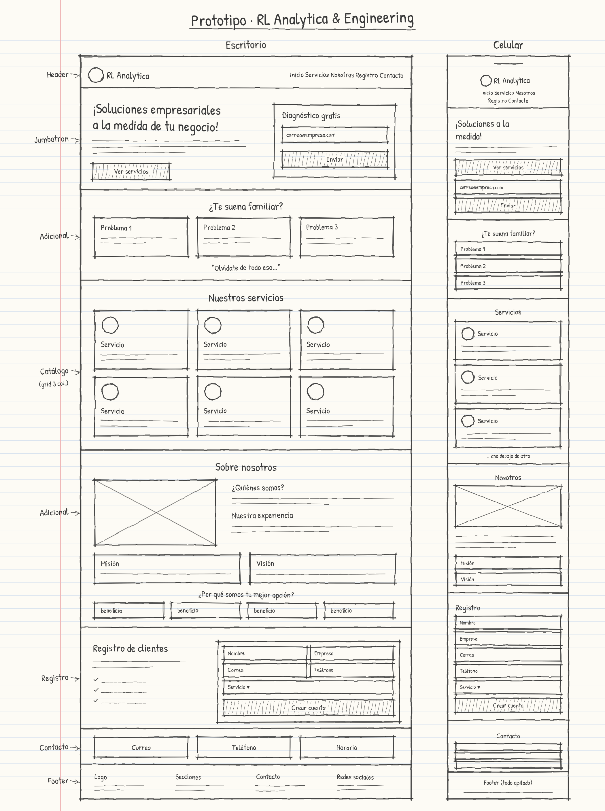

# RL Analytica & Engineering | Landing de negocio

Página web estática tipo *landing* para RL Analytica & Engineering, consultoría en automatización de procesos, analítica de datos y soluciones empresariales a la medida. Proyecto 1 del módulo Web Dev Fundamentals, desarrollado de forma individual por Rogelio López.

## Demo

[Ver sitio publicado](https://rogerld21.github.io/Proyecto_Pagina_Landing/)

## Objetivo

Presentar el negocio y su catálogo de servicios, captar el correo de empresas interesadas en un diagnóstico y permitir el registro de clientes.

## Prototipo

El prototipo de baja fidelidad (escritorio y móvil) se encuentra en la carpeta `prototipo`.

## Secciones

- **Header:** logotipo y navegación hacia las áreas principales del sitio.
- **Jumbotron:** título, descripción del negocio y campo para introducir el correo.
- **¿Te suena familiar?:** problemas comunes que resuelve el negocio.
- **Servicios:** catálogo de servicios con icono, descripción y herramientas.
- **Sobre nosotros:** quiénes somos, experiencia, misión, visión y por qué elegirnos.
- **Registro:** formulario de registro de clientes.
- **Contacto:** correo, teléfono y horario de atención.
- **Footer:** todas las áreas del sitio y redes sociales.

## Tecnologías

- HTML5 semántico (`header`, `nav`, `main`, `section`, `article`, `figure`, `form`, `footer`).
- CSS3 con distintos tipos de selectores (universal, de elemento, de clase, de id, de atributo, descendiente, hijo, hermano adyacente, hermano general, pseudoclases y pseudoelementos).
- Flexbox y CSS Grid.
- Responsive Web Design con media queries.

## Despliegue

Sitio publicado con GitHub Pages desde la rama `main`.
